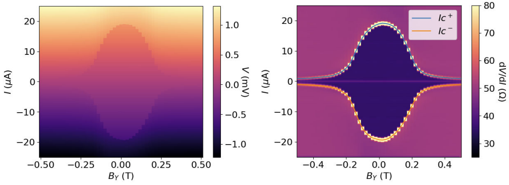

### Highlighted Projects

[Master Thesis](https://github.com/AbelHutten/master_thesis)

- Master thesis on fabrication and characterization of nanoscale electronic superconducting devices. Gold and Palladium nanoscale break-junctions, made using electron-beam lithography, and made superconducting via the proximity effect using a layer of Niobium. The devices showed asymmetric critical current when a magnetic field was applied, making this a novel way of producing Josephson diodes.

  

[Deformable Grouped Query Attention](https://github.com/AbelHutten/deformable-grouped-query-attention)

- Implemented deformable attention with grouped-query support. This is the first known instance of deformable attention enhanced with grouped-query attention, demonstrating a novel architectural combination for improved efficiency.

  

[TEP-Net-V2](https://github.com/AbelHutten/TEP-Net-V2)

- Experiments on improving [TEP-Net](https://github.com/irtrailenium/train-ego-path-detection), the current SOTA in rail vehicle ego path detection. Added confidence scores, improved out-of-distribution errors when a leading vehicle is close, worked on adding memory to handle otherwise ambiguous cases.
- [Contributed `torch.compile` integration back to the original TEP-Net](https://github.com/irtrailenium/train-ego-path-detection/pull/5), reducing training time by 17.7% on RTX 4090, with potentially greater speedups on datacenter GPUs.

[Stochastic-Calculus-for-Finance-I-and-II-Solutions](https://github.com/AbelHutten/Stochastic-Calculus-for-Finance-I-and-II-Solutions)

- Original solutions to the exercises in Stochastic Calculus for Finance I and II by Steven Shreve, written in Typst.

[AskePlaat-DRL-Solutions](https://github.com/AbelHutten/AskePlaat-DRL-Solutions)

- Solutions to most of the questions and many of the practical exercises in the textbook *Deep Reinforcement Learning* (2022) by Aske Plaat. Made as a reference for people working through these exercises. At the time of writing, the only one on the internet.
